# Chicago restaurant inspections: reproduce, beat, and stress-test the city's model

<!-- BEGIN:summary -->
This repo rebuilds the City of Chicago's 2014 restaurant-inspection model in Python and **reproduces its published result: 7.44 days earlier** (published 7.44) on the same 1,637 inspections, with the same first-half share (54.7% -> 68.2%) and coefficients within 0.007. Under the same rules, a blend of ridge logistic regression and LightGBM with new history, complaint, facility and neighborhood features finds critical violations **8.70 days earlier [5.77, 11.30]**, +1.32 days [+0.53, +2.12] versus the city's model in a paired bootstrap (a win: the interval is above zero; versus the city's XGBoost it is +0.93 [-0.02, +1.96]). **The inspector question:** most of the published gain depends on knowing who did each inspection. Scored with only what a scheduler knew on 2014-09-02, the city's model finds violations 2.06 days earlier [-0.82, 4.69], 72% less than published; my model keeps 6.10 days [3.27, 8.83].
<!-- END:summary -->

<!-- BEGIN:chart -->
<picture>
  <source media="(prefers-color-scheme: dark)" srcset="reports/figures/core2_cumulative-dark.png">
  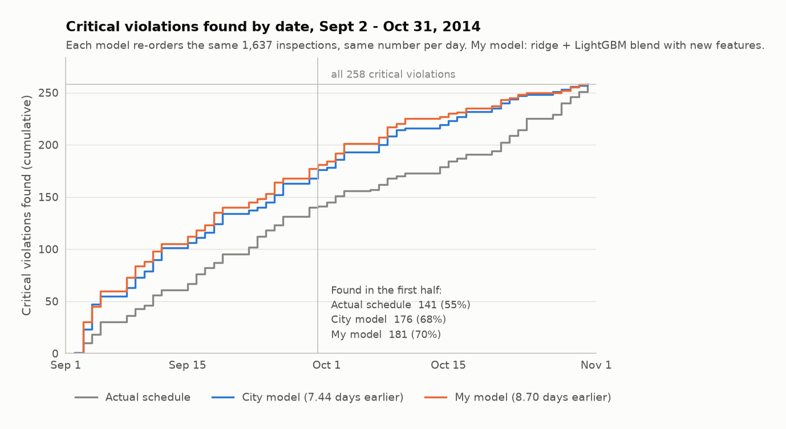
</picture>
<!-- END:chart -->

Every number, table and chart below is written by `scripts/reproduce.py` (Extension C's by
`scripts/nightly.py`); nothing is copied from a notebook.

## Core 1: the city's model, reproduced in Python

Ports of `CODE/30a_glmnet_model.R` (joins, transforms, ridge model that penalizes only the
inspector columns) and `CODE/30b_glmnet_model_evaluation.R` (the days-earlier simulation and
first-half share), run on the city's own data snapshot.

<!-- BEGIN:core1 -->
| Metric | City (R, published) | Python, published rows | Python, 2019 snapshot join |
|---|---|---|---|
| Test inspections / with a critical violation | 1,637 / 258 | 1,637 / 258 | 1,665 / 263 |
| Training inspections | 17,075 | 17,075 | 17,116 |
| Avg. days earlier | 7.44 | 7.44 | 7.59 |
| SD of days earlier | 25.20 | 25.24 | 25.10 |
| Median / max days earlier | 6 / 58 | 6 / 58 | 6 / 58 |
| Violations found later (share) | 99 (38%) | 99 (38%) | 100 (38%) |
| First-half share, actual -> model | 54.7% -> 68.2% | 54.7% -> 68.2% | 54.4% -> 68.4% |
| Test AUC (normalized Gini) | not published | 0.672 (0.344) | 0.675 (0.350) |
| Brier score | not published | 0.1266 | 0.1265 |
| City XGBoost (saved scores): days earlier / AUC | 7.79 / 0.679 | 7.79 / 0.679 |  |

<details><summary>Coefficients: city (R) vs. this port, glum and scikit-learn</summary>

| Variable | City (R) | Python port | glum | scikit-learn | Python - City |
|---|---|---|---|---|---|
| (Intercept) |  | -2.513 | -2.513 | -2.513 |  |
| Inspector blue | 0.950 | 0.953 | 0.953 | 0.953 | +0.003 |
| Inspector brown | -1.306 | -1.304 | -1.304 | -1.304 | +0.002 |
| Inspector green | -0.244 | -0.241 | -0.241 | -0.241 | +0.003 |
| Inspector orange | 0.202 | 0.205 | 0.205 | 0.205 | +0.003 |
| Inspector purple | 1.555 | 1.557 | 1.557 | 1.557 | +0.002 |
| Inspector yellow | -0.697 | -0.694 | -0.694 | -0.694 | +0.003 |
| pastSerious | 0.302 | 0.301 | 0.301 | 0.301 | -0.001 |
| pastCritical | 0.427 | 0.428 | 0.428 | 0.428 | +0.001 |
| timeSinceLast | 0.097 | 0.097 | 0.097 | 0.097 | +0.000 |
| ageAtInspection | -0.164 | -0.164 | -0.164 | -0.164 | +0.000 |
| consumption_on_premises_incidental_activity | 0.411 | 0.404 | 0.404 | 0.404 | -0.007 |
| tobacco | 0.171 | 0.169 | 0.169 | 0.169 | -0.002 |
| temperatureMax | 0.005 | 0.005 | 0.005 | 0.005 | -0.000 |
| heat_burglary | 0.002 | 0.002 | 0.002 | 0.002 | +0.000 |
| heat_sanitation | 0.002 | 0.002 | 0.002 | 0.002 | -0.000 |
| heat_garbage | -0.004 | -0.004 | -0.004 | -0.004 | -0.000 |

</details>

**Why the small gaps, and what it took to get here**

- **Row set.** Joining today's snapshot exactly as `CODE/30a_glmnet_model.R` does gives 18,781 rows (1,665 test, 263 positives), not the published 1,637 / 258. The city's 2019 refactor (v1.7.0) regenerated the inspector assignments and the business-license extract. The only file in the snapshot with exactly the published rows is `DATA/30_xgboost_data.Rds` (saved in 2017), so benchmark comparisons use its 18,712 Inspection_IDs with features from the 2019 files. On the full 2019 join the same model gives 7.59 days.

- **Penalty.** The report's model was not cross-validated: the 2015 script fits `glmnet` on the training rows and takes the 100th (smallest) lambda on the path (`w.lam <- 100`). The 2019 script uses `cv.glmnet`'s `lambda.min`. Here 10-fold CV picks the 100th lambda in 100% of 50 fold seeds, so both give 7.44 days.

- **Coefficients** differ by at most 0.007. Between the 2017 and 2019 extracts, 17 liquor-consumption flags and 3 tobacco flags changed; refitting on the city's 2017 feature values brings the unpenalized coefficients within 0.001 and the SD to 25.21. A gap of up to 0.003 remains on the six penalized inspector coefficients that I could not explain (glmnet's looser convergence tolerance is the likely cause). Matching lambda took reading glmnet's Fortran: for ridge (alpha = 0) its strong rule admits every variable at once, so lambda_max comes from the intercept-only gradient, not the gradient after the unpenalized columns are fitted. glum and scikit-learn (the guide's two routes) agree with this port to 5e-05.

- **Dates.** Training data run 2011-09-02 to 2014-04-16; the test window is 2014-09-02 to 2014-10-31. The 4.5-month gap means the code's "last 90 days" rule and the 2015 script's "before 2014-07-01" rule select the same rows.

- **History features rebuilt from raw data** (`CODE/23_food_insp_features.R` port) match the city's file for 100% of 27,600 inspections, and the density (KDE) port matches `22_*_heat.Rds` to floating-point precision.

- **Standard metrics.** The city published no AUC for this model; its normalized Gini equals 2 x AUC - 1. Calibration on the test window:

<picture>
  <source media="(prefers-color-scheme: dark)" srcset="reports/figures/core1_calibration-dark.png">
  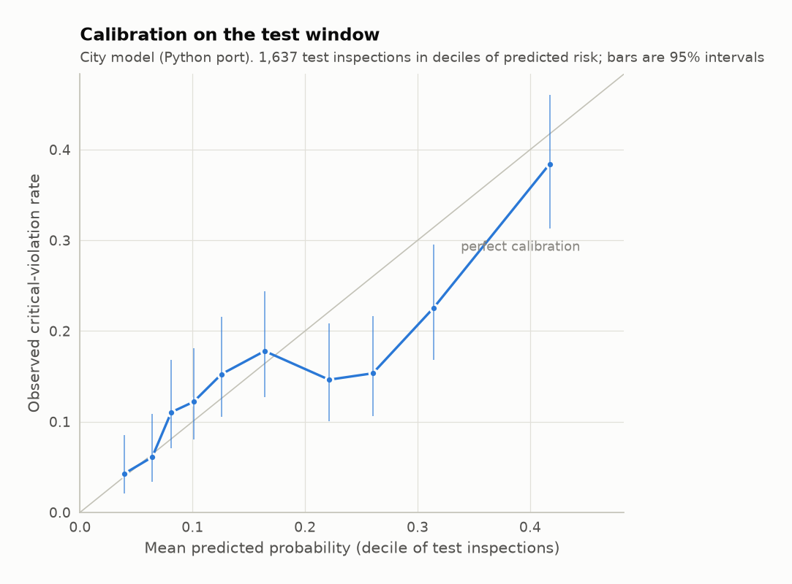
</picture>
<!-- END:core1 -->

## Core 2: beating the benchmark

<!-- BEGIN:core2 -->
Same rows, split, target and metric code as Core 1. Choices were made only inside the training period: six rolling windows (train before a cutoff, validate on the next two months; cutoffs May 2013 to March 2014), never random K-fold, because a restaurant's later visits would leak into training. Hyperparameters were chosen by validation log-loss and the model family by validation days-earlier; the test window was then scored once per final model. Every model was run with and without the inspector feature.

| Model | Inspector | Validation days earlier | Test days earlier [95% CI] | Minus city [95% CI] | SD | Found later | First-half share | AUC |
|---|---|---|---|---|---|---|---|---|
| City GLM (Core 1 port, published) | yes | 10.41 | 7.44 [4.38, 9.94] | - | 25.2 | 99 | 68.2% | 0.672 |
| City XGBoost (saved 2017 scores) | yes |  | 7.79 [4.91, 10.33] | +0.38 [-0.31, +1.09] | 25.0 | 104 | 68.2% | 0.679 |
| LightGBM, city features | yes | 10.33 | 7.74 [4.74, 10.25] | +0.32 [-0.02, +0.72] | 24.8 | 99 | 67.8% | 0.678 |
| Ridge logistic, extended features | yes | 10.85 | 8.23 [5.24, 10.84] | +0.89 [+0.11, +1.67] | 25.4 | 96 | 70.9% | 0.689 |
| LightGBM, extended features | yes | 10.81 | 8.99 [6.18, 11.55] | +1.59 [+0.68, +2.44] | 24.5 | 94 | 70.5% | 0.702 |
| Blend (ridge + LightGBM), extended features **(selected)** | yes | 10.94 | 8.70 [5.77, 11.30] | +1.32 [+0.53, +2.12] | 25.0 | 95 | 70.2% | 0.697 |
| City GLM (Core 1) | no | 3.15 | 2.20 [-0.66, 4.66] | -5.26 [-7.07, -3.42] | 25.4 | 124 | 56.6% | 0.570 |
| LightGBM, city features | no | 2.58 | 2.74 [0.15, 5.10] | -4.68 [-6.69, -2.72] | 24.2 | 120 | 57.0% | 0.580 |
| Ridge logistic, extended features | no | 6.18 | 5.51 [2.73, 8.15] | -1.85 [-3.51, -0.12] | 25.8 | 104 | 64.7% | 0.636 |
| LightGBM, extended features | no | 6.20 | 6.42 [3.58, 9.06] | -0.97 [-2.80, +0.83] | 25.5 | 93 | 69.0% | 0.653 |
| Blend (ridge + LightGBM), extended features | no | 6.39 | 6.09 [3.28, 8.78] | -1.27 [-3.03, +0.39] | 25.6 | 98 | 66.3% | 0.647 |

Intervals: 1,000 paired bootstrap resamples of the 1,637 test inspections; resampling whole days instead gives [+0.43, +2.14] for the selected model. The other criteria in the city's CONTRIBUTING.md: spread 25.0 vs 25.2 days, 95 vs 99 violations found later, first-half share 70.2% vs 68.2%. Probabilities: Brier 0.1224 vs 0.1266 for the city model (calibration chart below).

<details><summary>Feature ablation (validation only) and gain importance</summary>

| Feature group removed | Validation days earlier | Validation AUC | Change in days |
|---|---|---|---|
| (none: selected model) | 10.94 | 0.737 | +0.00 |
| Longer history | 10.65 | 0.731 | -0.29 |
| Complaint inspections | 10.98 | 0.737 | +0.04 |
| Past violation codes | 10.78 | 0.733 | -0.16 |
| Facility type and risk level | 10.86 | 0.734 | -0.07 |
| Nearby restaurants' critical rate | 10.99 | 0.738 | +0.05 |

| Feature | Share of gain |
|---|---|
| Inspector_purple | 19.0% |
| Inspector_blue | 17.1% |
| Inspector_brown | 6.6% |
| nearby_crit_rate_180d | 4.3% |
| Inspector_orange | 4.2% |
| temperatureMax | 3.7% |
| Inspector_green | 3.5% |
| Inspector_yellow | 3.5% |
| risk_level | 3.4% |
| n_crit_2y | 2.9% |
| canvass_crit_share | 2.7% |
| nearby_n_180d | 2.5% |
| n_serious_2y | 2.4% |
| days_since_any | 2.3% |
| heat_garbage | 2.3% |

<picture>
  <source media="(prefers-color-scheme: dark)" srcset="reports/figures/core2_calibration-dark.png">
  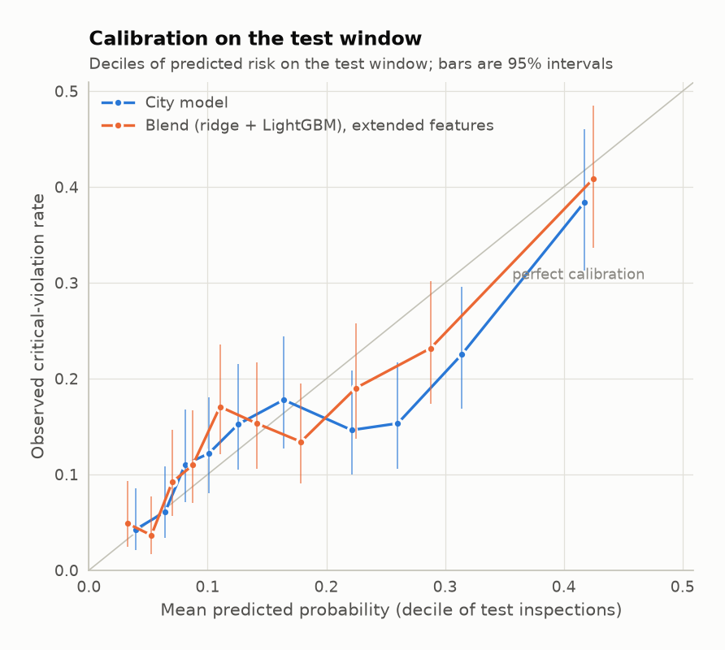
</picture>

</details>
<!-- END:core2 -->

## Core 3: the inspector question

<!-- BEGIN:core3 -->
The backtest moves each inspection to a new day but keeps the score computed with the inspector who actually did it, the temperature of its actual date and the time since its last visit measured to that date. The rows below remove the inspector, then rebuild every feature as of 2014-09-02 (history and license age up to that date, density windows ending that date, no inspector, no temperature) and rank once.

| Setup | Inspector known? | Features as of | Days earlier (95% interval) | Change vs published [95% CI] | First-half share | Found later | AUC |
|---|---|---|---|---|---|---|---|
| City's published setup | Yes | Actual inspection date | 7.44 [4.38, 9.94] | - | 68.2% | 99 | 0.672 |
| Same model, no inspector | No | Actual inspection date | 2.20 [-0.66, 4.66] | -5.26 [-7.07, -3.42] | 56.6% | 124 | 0.570 |
| Same model, no inspector or temperature | No | Actual inspection date | 1.93 [-0.97, 4.56] | -5.48 [-7.40, -3.60] | 55.4% | 121 | 0.566 |
| Same model, as of day one | No | 2014-09-02 | 2.06 [-0.82, 4.69] | -5.30 [-7.14, -3.50] | 57.0% | 119 | 0.570 |
| My best model (Blend (ridge + LightGBM), extended features) | Yes | Actual inspection date | 8.70 [5.77, 11.30] | +1.32 [+0.53, +2.12] | 70.2% | 95 | 0.697 |
| My best model, no inspector | No | Actual inspection date | 6.09 [3.28, 8.78] | -1.27 [-3.03, +0.39] | 66.3% | 98 | 0.647 |
| My best model, as of day one | No | 2014-09-02 | 6.10 [3.27, 8.83] | -1.24 [-3.02, +0.45] | 67.1% | 99 | 0.648 |

**Strict inspectors or dirty kitchens?** For the restaurants each cluster visited, the non-inspector features predict similar critical rates (12.7% to 15.4%), but the clusters record 2.4% (brown) to 40.6% (purple): observed/expected from 0.19 to 2.64. "Critical violation found" measures the inspector as well as the kitchen.

| Cluster | Training inspections | Actual critical rate | Expected from non-inspector features | Observed / expected [95% CI] | City coefficient |
|---|---|---|---|---|---|
| brown | 1,878 | 2.4% | 12.7% | 0.19 [0.14, 0.25] | -1.31 |
| yellow | 2,762 | 5.8% | 13.9% | 0.41 [0.35, 0.48] | -0.70 |
| green | 4,595 | 9.5% | 14.6% | 0.65 [0.59, 0.71] | -0.24 |
| orange | 3,769 | 13.6% | 13.4% | 1.02 [0.93, 1.10] | +0.20 |
| blue | 2,897 | 26.5% | 14.5% | 1.83 [1.72, 1.95] | +0.95 |
| purple | 1,174 | 40.6% | 15.4% | 2.64 [2.45, 2.82] | +1.55 |

<picture>
  <source media="(prefers-color-scheme: dark)" srcset="reports/figures/core3_stringency-dark.png">
  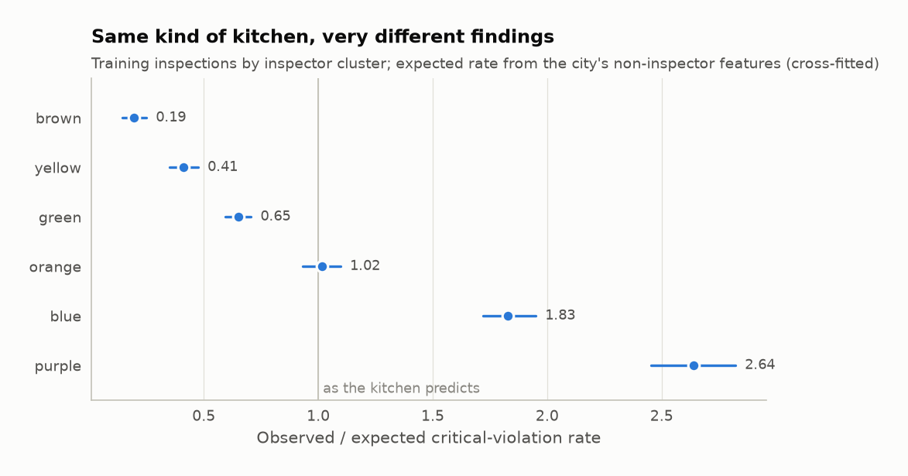
</picture>

**Knock-on effect.** After a visit by a lenient cluster, pastCritical = 1 is rare (7.2% vs 22.7% after a strict one), so it separates kitchens worse: AUC of pastCritical alone 0.521 [0.508, 0.533] vs 0.565 [0.543, 0.586] (7,687 training inspections with a known previous inspector). When it does fire, its effect is similar: the interaction pastCritical x strict-previous in a logistic model with the current inspector as control is +0.19 (SE 0.20, p = 0.32).

**Geography.** Clusters work in particular areas: Cramér's V between cluster and community area is 0.50, and the strictest cluster (purple) does 97% of its inspections in just ten of the 77 community areas. Inspector and neighborhood effects are tangled, which matters for Extension B.

<picture>
  <source media="(prefers-color-scheme: dark)" srcset="reports/figures/core3_cluster_maps-dark.png">
  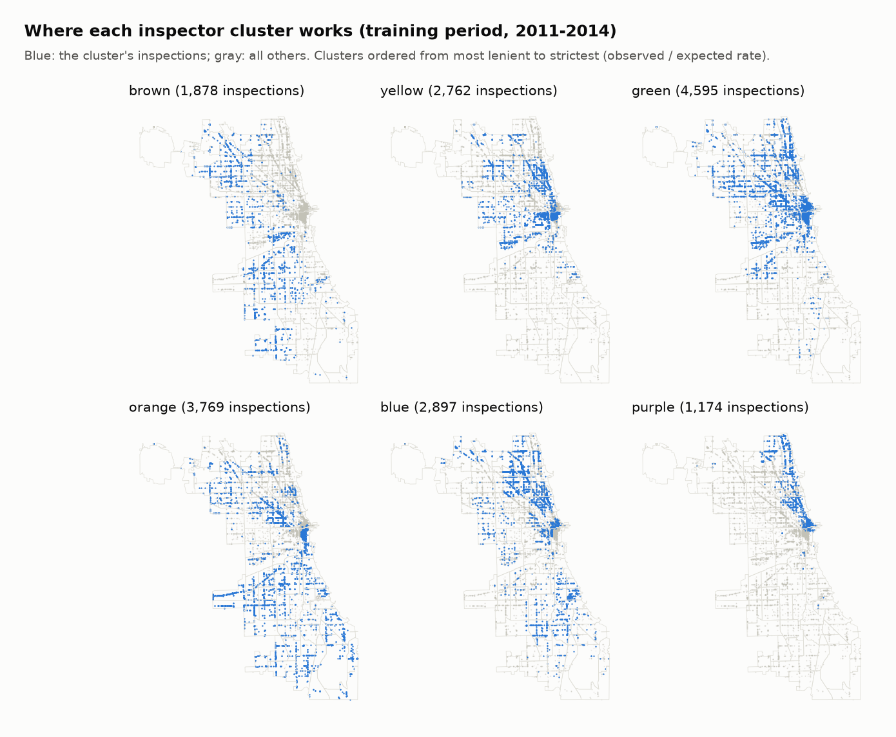
</picture>
<!-- END:core3 -->

## What I found

<!-- BEGIN:findings -->
The city's 7.44 days mostly come from one variable a scheduler cannot use. Removing the inspector clusters cuts the city model to 2.20 days [-0.66, 4.66], 70% less, and rebuilding the remaining features as of the first day of the window changes little more (2.06 days, an interval that includes zero). The inspector variable is strong because clusters differ in how often they record a critical violation for similar kitchens (0.19x to 2.64x the expected rate), and in the backtest each inspection keeps the score of the inspector who actually did it. Better history features recover much of the gap honestly: my model scored as of day one finds violations 6.10 days earlier [3.27, 8.83]. The report already said the daily model drops inspectors; these numbers show what that costs.
<!-- END:findings -->

## What I tried that didn't work (and what did)

<!-- BEGIN:tried -->
- **Gradient-boosted trees on the city's own ten features** (LightGBM): 7.74 days, +0.32 [-0.02, +0.72] vs the city model. Trees alone add little; the gain comes from new inputs.
- **New features in a ridge logistic regression** (longer history, complaint inspections, facility type and risk level, past violation codes, nearby restaurants' critical rate): 8.23 days, +0.89 [+0.11, +1.67] vs the city model.
- **The same features in LightGBM**: 8.99 days, +1.59 [+0.68, +2.44] vs the city model. This is the best test number, but it was not the validation winner, so it is not the headline model.
- **A 50/50 blend of the two**, selected on validation: 8.70 days, +1.32 [+0.53, +2.12] vs the city model.
- **Which new features matter** (validation only): removing longer history costs the most (-0.29 days); see the ablation table.
- **Hyperparameters**: 48 configurations, chosen by validation log-loss. The selected trees have 7 leaves and 300 rounds; the deepest setting (31 leaves) was worse in every variant.
- **Isotonic calibration** fitted on earlier validation windows did not improve Brier score on later windows (0.1100 raw vs 0.1113), so it was dropped; the raw blend is already close (mean prediction 0.161 vs observed rate 0.158 on the test window).
- **Left out on purpose**: ten more license categories the city computed but never used (tavern, outdoor patio, ...). The city's code attaches them by license end date, which can postdate the inspection.
- **Validation is optimistic**: windows right after each cutoff score 10.94 days for the selected model, the test window (4.5 months after training ends) 8.70.
<!-- END:tried -->

## Extensions

### A. Neighborhood fairness audit

<!-- BEGIN:ext_b -->
Inspections were placed in Chicago's 77 community areas with a spatial join (24 of 1,637 test inspections fall outside the polygons and are left out), then grouped into thirds of community areas by the 2008-2012 hardship index. Fairness definition: **calibration within groups**, because a scheduler acts on predicted risk; the other four metrics from the guide are shown too. All intervals are 1,000 bootstrap resamples (simulation re-run each time), and the simulation runs on the 1,613 placed inspections, so overall days-earlier here differ slightly from the 1,637-inspection headline.

**Findings.** The city's model over-predicts risk in low-hardship areas by +3.5 percentage points [+1.2, +5.6], the one calibration gap whose interval excludes zero (mine: +1.0). The time savings go there too: under the city's model violations in low-hardship areas are found 13.6 days earlier, while those in middle-hardship areas are found 8.8 days *later* [1.2, 17.2] than in the actual schedule. Low-hardship areas do have the highest actual critical rate in the window, so part of this is risk-based prioritizing; my model narrows the middle-hardship loss to 5.4 days but does not close it.

| Hardship group | Test inspections (violations) | Actual rate | Predicted minus actual, city | Predicted minus actual, mine | First-half share minus violation share, city | First-half share minus violation share, mine | Days earlier, city | Days earlier, mine |
|---|---|---|---|---|---|---|---|---|
| Low hardship | 1,002 (179) | 17.9% | +0.035 [+0.012, +0.056] | +0.010 [-0.012, +0.030] | +0.057 [-0.004, +0.116] | +0.041 [-0.017, +0.093] | 13.6 [10.7, 16.9] | 13.9 [10.8, 17.2] |
| Middle | 284 (28) | 9.9% | +0.009 [-0.026, +0.042] | +0.007 [-0.029, +0.040] | -0.039 [-0.078, +0.001] | -0.028 [-0.064, +0.013] | -8.8 [-17.2, -1.2] | -5.4 [-14.0, 2.8] |
| High hardship | 327 (46) | 14.1% | -0.003 [-0.045, +0.037] | -0.011 [-0.052, +0.027] | -0.018 [-0.068, +0.035] | -0.013 [-0.059, +0.037] | -4.7 [-10.3, 1.6] | -0.8 [-6.2, 5.9] |

<details><summary>Burden on owners and exposure for residents</summary>

| Hardship group | Clean restaurants in first half, city | Clean restaurants in first half, mine | Violations left for the second half, city | Violations left for the second half, mine |
|---|---|---|---|---|
| Low hardship | 56.9% [53.7%, 59.6%] | 55.0% [51.6%, 58.1%] | 37 [27, 48] | 35 [24, 47] |
| Middle | 18.8% [14.2%, 24.5%] | 21.5% [16.9%, 26.8%] | 19 [11, 27] | 17 [9, 25] |
| High hardship | 38.4% [31.4%, 46.5%] | 39.9% [33.7%, 46.1%] | 23 [14, 35] | 23 [13, 32] |

</details>

**Cause and fix.** The three density features come from crime and 311 reports, which reflect neighborhood conditions and reporting habits, not the kitchen. Dropping them changes my model's accuracy by +0.09 days and its largest calibration gap from 2.1 to 1.5 percentage points; recalibrating within groups (fitted on validation months) is the second fix tried. Strict inspector clusters do 44% (low hardship), 60% (middle), 43% (high hardship) of inspections by group, so inspector and neighborhood effects overlap.

| Model | Days earlier [95% CI] | AUC | Largest calibration gap, pp [95% CI] |
|---|---|---|---|
| City model | 7.81 [5.13, 10.55] | 0.676 | 3.8 [1.1, 8.5] |
| City model, no density features | 7.95 [5.23, 10.68] | 0.679 | 3.1 [0.9, 8.0] |
| My model | 9.09 [6.42, 11.97] | 0.701 | 2.1 [0.6, 7.2] |
| My model, no density features | 9.19 [6.43, 12.01] | 0.701 | 1.5 [0.5, 6.8] |
| My model, recalibrated within groups | 9.15 [6.42, 11.97] | 0.701 | 1.7 [0.6, 6.8] |

<picture>
  <source media="(prefers-color-scheme: dark)" srcset="reports/figures/ext_b_tradeoff-dark.png">
  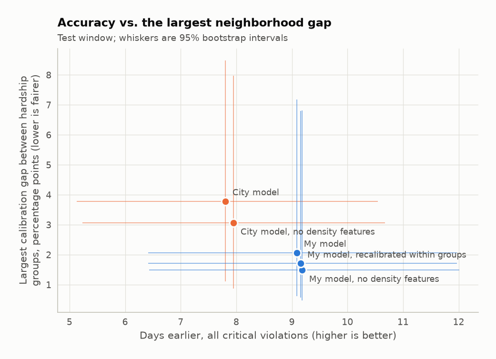
</picture>

<picture>
  <source media="(prefers-color-scheme: dark)" srcset="reports/figures/ext_b_area_maps-dark.png">
  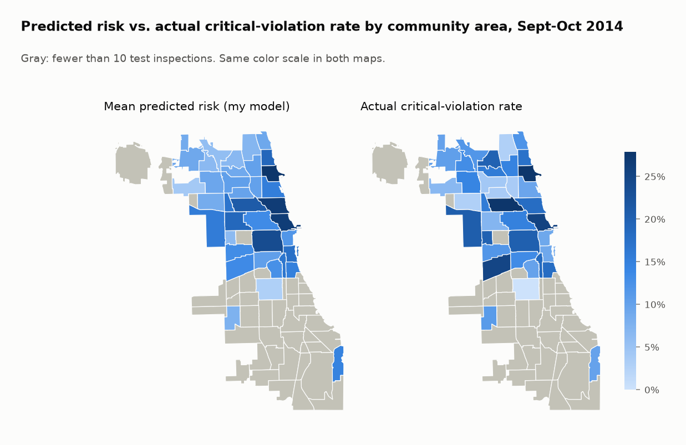
</picture>
<!-- END:ext_b -->

### B. Inspection scheduling

<!-- BEGIN:ext_a -->
A team orienteering problem in OR-Tools, solved day by day over the window (rolling horizon): each inspector's travel plus inspection time must fit one shift, each restaurant is visited at most once, each day's visits are capped at the canvass inspections actually done that day, and skipping a restaurant costs its predicted risk. Travel time is Manhattan distance at an assumed speed. Scores: my model without inspector features, as of 2014-09-02 (Core 3). Baseline assumptions: 10 inspectors on canvass duty, 7-hour field shifts, 60 minutes per inspection, 20 km/h, one central office; guided local search for 10 s per day.

| Strategy | Avg. days earlier | Critical violations found in first half | Travel hours (window total) | Overtime hours | Inspections per inspector-day | Not reached by Oct 31 |
|---|---|---|---|---|---|---|
| Actual | 0.00 | 54.7% | 534 | 2 | 4.7 | 0 |
| Ranking only (city's method) | 6.10 | 67.1% | 547 | 4 | 4.7 | 0 |
| Ranking plus routing (OR-Tools) | 6.09 | 66.7% | 509 | 0 | 4.8 | 3 |
| Geography only | 0.90 | 56.2% | 364 | 0 | 5.1 | 20 |

<picture>
  <source media="(prefers-color-scheme: dark)" srcset="reports/figures/ext_a_cumulative-dark.png">
  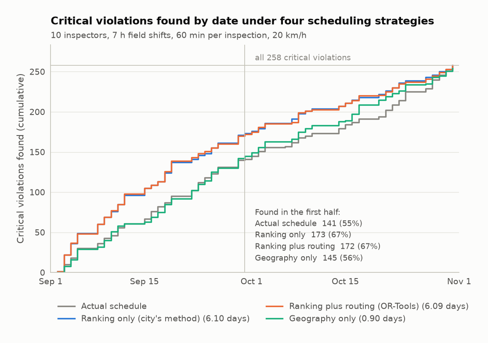
</picture>

**Sensitivity** (each assumption moved by 50%, 3 s search per day). "Ranking only" keeps its days-earlier because it ignores capacity; its overtime column is what that costs. The routing plan respects shifts, so when capacity binds it leaves restaurants unreached by Oct 31 (counted as found the day after).

| Assumption | Routing: days earlier | Routing: travel h | Routing: not reached | Ranking only: days earlier | Ranking only: travel h | Ranking only: overtime h |
|---|---|---|---|---|---|---|
| inspectors = 5 | -2.85 | 321 | 585 | 6.10 | 391 | 582 |
| inspectors = 15 | 6.14 | 520 | 0 | 6.10 | 551 | 0 |
| shift_min = 210 | -6.88 | 442 | 842 | 6.10 | 553 | 738 |
| shift_min = 630 | 6.11 | 390 | 0 | 6.10 | 414 | 0 |
| service_min = 30 | 6.14 | 364 | 0 | 6.10 | 396 | 0 |
| service_min = 90 | 2.10 | 542 | 282 | 6.10 | 602 | 298 |
| speed_kmh = 10.0 | 4.35 | 1,076 | 153 | 6.10 | 1,259 | 169 |
| speed_kmh = 30.0 | 6.15 | 326 | 1 | 6.10 | 337 | 0 |
| start = zones | 6.19 | 271 | 0 | 6.10 | 317 | 0 |
| (baseline, 3 s limit) | 6.09 | 512 | 5 | 6.10 | 547 | 3 |

<picture>
  <source media="(prefers-color-scheme: dark)" srcset="reports/figures/ext_a_routes-dark.png">
  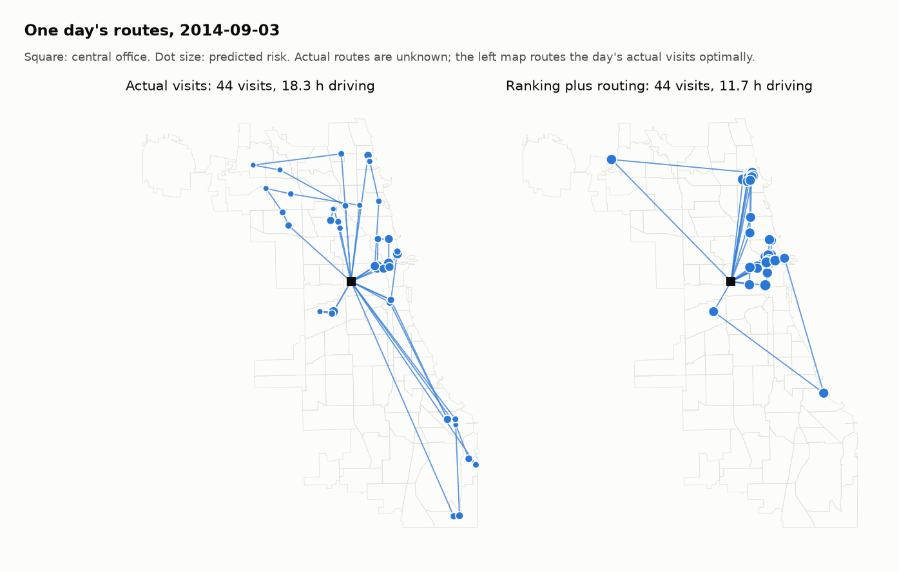
</picture>

Caveats: complaint, license and re-inspections also take inspector time and are not planned here; like the city's backtest this assumes a violation found on day 40 would also have been there on day 1; actual routes are unknown, so the "Actual" travel is the optimal route through each day's actual visits (a lower bound); 0 test inspections lacked coordinates. The planner sends inspectors where predicted risk is concentrated (mostly the north side on the day mapped), which is the neighborhood question Extension B measures. OR-Tools' local search is time-limited, so travel hours can differ slightly between machines (compare the 10 s baseline with the 3 s row); every other number in this README is deterministic. The guide suggests PATH_CHEAPEST_ARC for the first solution, but under the daily visit cap it returns an empty plan, so optional-visit problems start from PARALLEL_CHEAPEST_INSERTION.
<!-- END:ext_a -->

### C. Live nightly scoring
[](https://github.com/chensirui3/chicago-inspection/actions/workflows/ci.yml) [](https://github.com/chensirui3/chicago-inspection/actions/workflows/nightly.yml)

**Live dashboard (Extension C):** https://chensirui3.github.io/chicago-inspection/, rebuilt nightly from the city's portal.
<!-- BEGIN:ext_c -->
**Label.** Under the 2018 food code a result of *Pass* means no Priority (P) or Priority Foundation (PF) violation, *Pass w/ Conditions* means at least one was found and corrected on site, *Fail* means at least one could not be corrected. So "at least one P or PF violation" = Fail or Pass w/ Conditions. It is broader than the 2014 critical-only target (about 48% of canvass inspections vs 15.8% in the 2014 test window), so **these numbers are not comparable with the 7.44 days**. History before July 2018 uses "any critical or serious violation" (codes 1-29), never old results. Completed canvass inspections only (Out of Business, No Entry, Business Not Located and Not Ready dropped).

**Data.** Food Inspections from July 2016 (history), Business Licenses (license age > 4 years, and whether the business account holds a liquor-consumption or tobacco license), Crimes (burglaries) and 311 Service Requests ("Sanitation Code Violation" and "Garbage Cart Maintenance" are the exact type names; duplicates and canceled requests dropped) for the 90-day densities, NOAA daily maximum temperature at O'Hare. The new 311 system starts Dec 18, 2018, so the modeling table starts 2019-03-18: 46,922 canvass inspections outside the pandemic period (Mar 16, 2020 to Jun 30, 2021, when volumes collapsed and rates shifted; it is excluded from training and flagged in the backtest). 83% of canvass inspections match a business license by license number (logged every night).

**Forward validation.** Train through one month, score the next, slide month by month (same ridge + LightGBM blend as Core 2, no inspector features). Over the last 12 full months the model finds P/PF violations 2.8 days earlier on average within each month (range 1.2 to 4.3; AUC 0.665). The days are smaller than a two-month window's because each month spans half as many days. The label drifted: 73% of canvass inspections found a P/PF violation in 2019, 39% over the last 12 months, so calibration drifts too; retraining every night and the calibration monitor exist for that.

**Nightly job** (`.github/workflows/nightly.yml`, cron in UTC): fetch rows changed since the last run with the app token from the `SOCRATA_APP_TOKEN` secret; validate columns, row counts and freshness and fail loudly otherwise; rebuild features as of today; retrain; score the 8,793 retail food establishments due for a canvass (risk 1 after 6 months, risk 2 after a year, risk 3 after two); publish a static GitHub Pages dashboard (map by community area, score distribution, monthly backtest, last-updated time) and its CSV/JSON; compare earlier predictions with outcomes since for a calibration chart. Last local run: 2026-11-04 00:54 CST.

**Publishing responsibly.** The page and its data files show only community-area aggregates (areas with fewer than 5 due establishments are suppressed) and model diagnostics. A score is a prediction, not an inspection result, so no ranked list of named restaurants is published; per-restaurant predictions stay in the private Actions cache for monitoring. Individual restaurants' actual results are already on the city's portal.

**Status.** Built and run locally against the live portal; the GitHub Actions workflow has not run yet (it needs this repo on GitHub, Settings > Pages > Source set to GitHub Actions, and a free Socrata app token saved as the `SOCRATA_APP_TOKEN` secret), so the guide's "two weeks without manual fixes" bar is not met yet. Scheduled workflows in public repos stop after 60 days without activity: re-enable with `gh workflow enable nightly.yml` and check the page's date.

| Period | Months | Inspections | P/PF rate | Mean days earlier per month | Mean AUC |
|---|---|---|---|---|---|
| 2019 | 4 | 2,781 | 72.8% | 2.04 | 0.752 |
| 2020 | 2 | 1,606 | 58.7% | 1.20 | 0.616 |
| 2020-21 (pandemic, excluded from training) | 16 | 8,121 | 55.4% | 2.22 | 0.670 |
| 2021 | 6 | 2,605 | 48.6% | 2.13 | 0.651 |
| 2022 | 12 | 6,588 | 47.9% | 2.04 | 0.634 |
| 2023 | 12 | 7,222 | 46.3% | 2.09 | 0.638 |
| 2024 | 12 | 8,531 | 42.9% | 2.45 | 0.651 |
| 2025 | 12 | 8,311 | 39.5% | 3.31 | 0.690 |
| 2026 | 9 | 4,942 | 39.7% | 2.46 | 0.644 |

<picture>
  <source media="(prefers-color-scheme: dark)" srcset="reports/figures/ext_c_backtest-dark.png">
  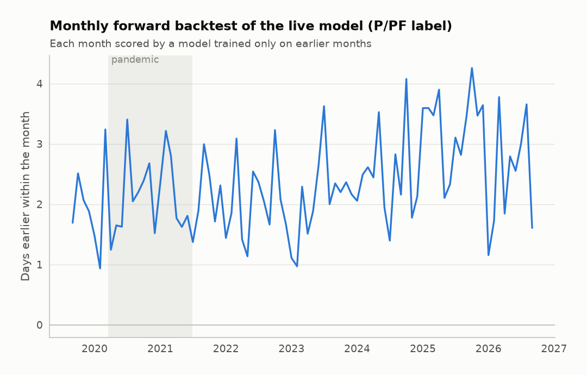
</picture>

<picture>
  <source media="(prefers-color-scheme: dark)" srcset="reports/figures/ext_c_monthly-dark.png">
  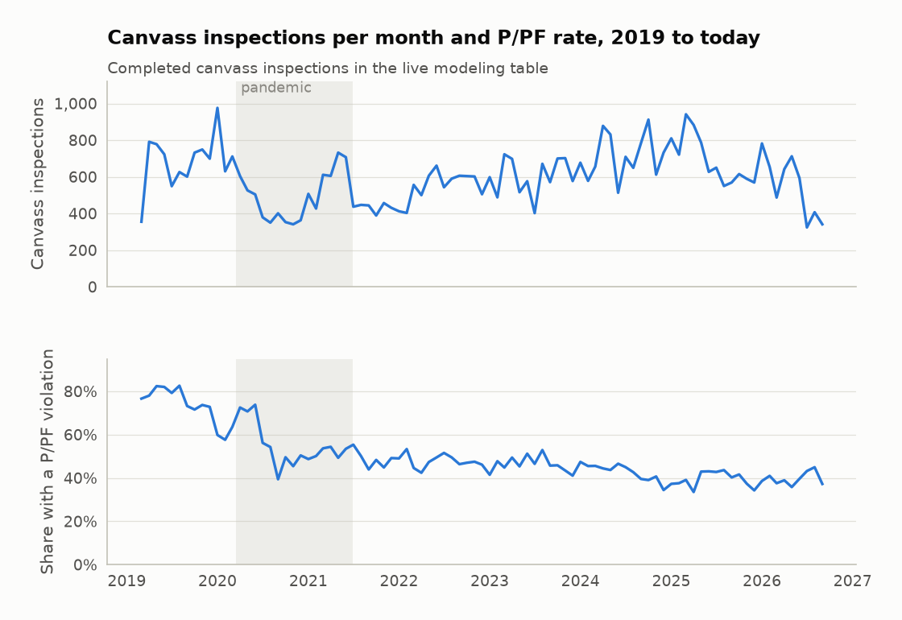
</picture>
<!-- END:ext_c -->

## Limitations

- **One two-month test window** (Sept 2 to Oct 31, 2014, 258 violations). The average
  days-earlier has a standard error of about 1.6 days, so only paired comparisons are
  meaningful, and a different window could rank the models differently.
- **Labels depend on who inspects.** "Critical violation found" varies roughly 14-fold across
  inspector clusters for similar kitchens (Core 3), so every model here partly predicts the
  inspector, and every evaluation inherits that noise.
- **The backtest assumes violations don't change within the window**: a violation found on
  day 40 is assumed to have been there on day 1. This is untestable, and it flatters every
  ranking model equally.
- **2014 data.** The food code changed on July 1, 2018 (critical/serious became Priority /
  Priority Foundation); the 2014 results do not carry over, which is why Extension C defines a
  new label.
- **Rebuilt rows.** The 2019 snapshot no longer joins to the published row set by itself; the
  benchmark rows come from the city's own 2017 table (see Core 1).
- **Scheduling assumptions** (Extension A) are not observed; the sensitivity table shows how
  much they matter.

## How to run

```bash
make setup data
```

```bash
make reproduce
```

```bash
make test
```

`make setup data` installs the pinned dependencies (`requirements-lock.txt`, Python 3.12) and
clones the city's repository at a pinned commit to copy its `DATA/` folder into `data/raw/`
(checksums verified; converted once to Parquet). `make reproduce` rebuilds every number and
chart (about 12 minutes on a 16-thread laptop, 7 of them in Extension A's OR-Tools runs) and
rewrites the generated sections of this README. Without `make` (for example on Windows):
`pip install -r requirements-lock.txt && pip install -e . --no-deps`, then
`python scripts/get_data.py --portal`, `python scripts/reproduce.py --update-readme` and
`pytest`. Extension C runs with `python scripts/nightly.py`.

Random seeds are fixed in `src/inspections/config.py`; LightGBM runs in deterministic mode.

## Repository layout

```
├── README.md
├── pyproject.toml            # pinned direct dependencies; requirements-lock.txt pins everything
├── Makefile                  # make setup / data / reproduce / test / nightly
├── data/                     # git-ignored: raw .Rds files, Parquet cache, live portal pulls
├── src/inspections/
│   ├── load.py               # .Rds reader (rdata), Parquet cache, Socrata and NOAA clients
│   ├── features.py           # ports of the city's feature code + new features
│   ├── models.py             # exact glmnet port, glum / scikit-learn routes, LightGBM
│   ├── evaluate.py           # days-earlier simulation, first-half share, bootstrap
│   ├── core1.py core2.py core3.py
│   ├── fairness.py           # Extension B
│   ├── schedule.py           # Extension A (OR-Tools)
│   ├── live.py site.py       # Extension C (nightly job, static dashboard)
│   └── plots.py report.py readme.py
├── scripts/                  # get_data.py, reproduce.py, benchmark.py, nightly.py
├── notebooks/                # exploration only
├── tests/                    # metric, features, glmnet port, live label; data-backed checks
├── reports/                  # results.json, tables/, figures/ (light and dark)
└── .github/workflows/        # ci.yml (lint + tests on every push), nightly.yml (Extension C)
```


## Credits and license

Built on the City of Chicago's
[food-inspections-evaluation](https://github.com/Chicago/food-inspections-evaluation) (code,
data snapshot and technical report), developed by the City with Allstate's analytics team and
the Civic Consulting Alliance. Files that port its R code say so in their docstrings and keep
its notice:

> Copyright, 2014 City of Chicago. Permission is hereby granted, free of charge, to any person
> obtaining a copy of this software ... (MIT-style; full text in [LICENSE](LICENSE)).

Live data: [City of Chicago Data Portal](https://data.cityofchicago.org) (Food Inspections,
Business Licenses, Crimes, 311 Service Requests, Community Areas, 2008-2012 socioeconomic
indicators) and NOAA GHCN-Daily (O'Hare). This project's own code is MIT-licensed
([LICENSE](LICENSE)).
